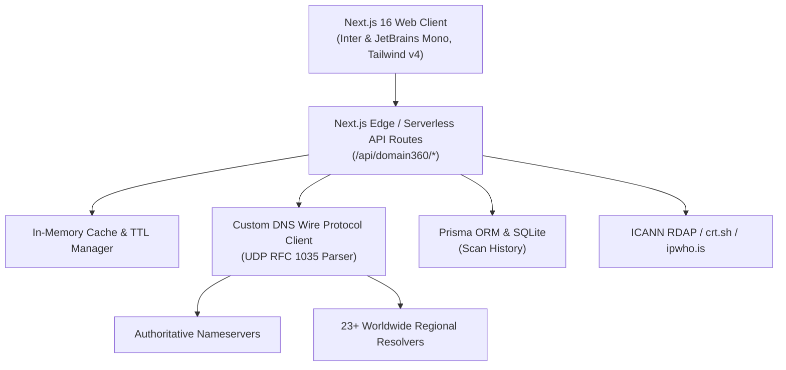

# Domain360 — Complete Domain Intelligence & Diagnostics Suite

[](https://domain360.vercel.app)
[](https://nextjs.org)
[](https://www.typescriptlang.org)
[](https://tailwindcss.com)
[](LICENSE)

**Domain360** is an enterprise-grade, privacy-respecting, zero-signup domain intelligence and diagnostic platform. It performs live, server-side passive probes across DNS, SSL/TLS, WHOIS/RDAP, email security, DNSSEC, HTTP headers, subdomain discovery, and global DNS propagation across 23+ worldwide geographic measurement nodes.

**Live Application**: [https://domain360.vercel.app](https://domain360.vercel.app)

---

## Table of Contents

- [Core Principles](#core-principles)
- [A to Z Feature Breakdown](#a-to-z-feature-breakdown)
- [Keyboard Shortcuts & Command Palette](#keyboard-shortcuts--command-palette)
- [Architecture & Tech Stack](#architecture--tech-stack)
- [Directory Structure](#directory-structure)
- [Getting Started Locally](#getting-started-locally)
- [Environment Configuration](#environment-configuration)
- [API Reference](#api-reference)
- [Deployment](#deployment)
- [Security & Fair Use](#security--fair-use)
- [License](#license)

---

## Core Principles

- **No Mock Data**: Every diagnostic runs real, live network queries (native RFC 1035 UDP DNS wire protocol, TLS socket handshakes, ICANN RDAP endpoints, and HTTP probes).
- **100% Free & Open**: Zero paywalls, zero artificial feature gates, zero forced signups.
- **Privacy & SSRF Protection**: Strictly passive analysis. Destructive testing is forbidden. Private RFC 1918 ranges, localhost, and cloud metadata endpoints are blocked at the socket level.
- **Modern Typography & UX**: Built with **Inter** and **JetBrains Mono**, featuring native light/dark modes, keyboard-first navigation (`⌘K`), and print/PDF reporting.

---

## A to Z Feature Breakdown

### 1. Domain Health Score & Overview
- **Transparent 0–100 Scoring**: Aggregates DNS, SSL/TLS, Email deliverability, WHOIS, HTTP security headers, and DNSSEC into a single, explainable score.
- **Categorized Breakdown**: Granular scoring with pass/warn/fail badges across all diagnostic pillars.
- **Actionable Findings**: Severity-graded recommendations (Critical, High, Medium, Low, Info) explaining root causes and specific remediation steps.

### 2. DNS Diagnostics (Basic & Advanced)
- **Standard Records**: Instant lookups for `A`, `AAAA`, `CNAME`, `MX`, `TXT`, `NS`, `SOA`, `CAA`, `PTR`, and `SRV`.
- **Advanced RFC Records**: Deep queries for `DNSKEY`, `DS`, `RRSIG`, `NSEC`, `NSEC3`, `TLSA`, `SVCB`, `HTTPS`, `LOC`, `CERT`, `URI`, and `DNAME`.
- **Custom Resolvers**: Compare authoritative answers against system resolvers or public providers:
  - Google Public DNS (`8.8.8.8`)
  - Cloudflare (`1.1.1.1`)
  - Quad9 (`9.9.9.9`)
  - Cisco OpenDNS (`208.67.222.222`)
  - AdGuard DNS (`94.140.14.14`)
- **DNS Wire Client**: Custom-built Node.js UDP socket client bypassing OS resolver caching for pure raw answers.

### 3. Global DNS Propagation
- **Interactive World Map**: Powered by Leaflet with real-time responsive pin clustering and status indicators.
- **23+ Worldwide Geographic Measurement Nodes**: Probes regional recursive resolvers located in:
  - **North America**: San Francisco, Ashburn, Mountain View, Clifton, Broomfield, Reston, Ottawa, Toronto, Montreal.
  - **Europe**: Frankfurt, Bielefeld, London, Zurich, Amsterdam, Limassol, Moscow.
  - **Asia-Pacific**: Hangzhou, Beijing, Shenzhen, Singapore, Seoul, Taipei, Melbourne.
- **Record Support**: Full country-wise propagation visibility for `A`, `AAAA`, `NS`, `MX`, `TXT`, `CNAME`, `SOA`, and `PTR`.
- **13 Independent Anycast Networks**: Side-by-side operator comparison showing latency, TTL, and cache divergence.

### 4. Authoritative Nameservers & Delegation Audit
- **Parent Zone Verification**: Queries parent root/TLD servers directly to verify child delegation.
- **Glue Records**: Inspects glue `A` records in the DNS response `ADDITIONAL` section.
- **SOA Serial Consistency**: Probes each authoritative nameserver directly with recursion disabled (`RD=0`) to detect replication lag or desynchronization.
- **GeoIP & ASN Lookup**: Identifies country flag, city, and ASN organization for each nameserver IP.
- **Lame Delegation Detection**: Flags unresponsive or misconfigured authoritative name servers.

### 5. IP & Hosting Intelligence
- **Dual-Stack Support**: Resolves all IPv4 and IPv6 addresses associated with the host.
- **Reverse DNS (PTR)**: Instant reverse DNS lookup and validation.
- **Autonomous System (ASN)**: ASN number, AS Name, ISP, and organization.
- **Geolocation**: Country flag, ISO code, city, region, postal code, and approximate coordinates.
- **Edge / CDN Detection**: Automatically identifies Cloudflare, Cloudfront, Fastly, Akamai, Azure CDN, and other edge providers.

### 6. SSL / TLS Certificate Analysis
- **Certificate Validity**: NotBefore / NotAfter timestamps and active expiry countdown.
- **Certificate Authority (CA)**: Full issuer metadata and root trust verification.
- **Subject Alternative Names (SANs)**: Complete list of protected hostnames.
- **Protocol Audit**: Tests server negotiation for TLS 1.0, TLS 1.1, TLS 1.2, and TLS 1.3.
- **Cipher Suite Inspection**: Identifies negotiated cipher, key length, and forward secrecy.
- **OCSP Stapling**: Checks online certificate status protocol stapling responses.

### 7. WHOIS & RDAP Lookup
- **ICANN RDAP Client**: Modern JSON-based Registration Data Access Protocol querying authoritative registries.
- **WHOIS Fallback**: Automatic RFC 3912 socket fallback when RDAP is unavailable.
- **Key Dates**: Creation date, last updated date, and registry expiration date.
- **Domain Status Codes**: Explains EPP status codes (`clientTransferProhibited`, `serverDeleteProhibited`, etc.).
- **Raw Output**: Full unparsed raw response with copy and syntax inspection.

### 8. Email Security & Deliverability
- **MX Infrastructure**: Priorities, mail hosts, country flags, and SMTP banner verification.
- **SPF Validator**: Syntactical validation, mechanism breakdown (`ip4`, `include`, `all`), and RFC 7208 10-lookup limit tracking.
- **DMARC Policy**: Enforces `p=none`, `p=quarantine`, or `p=reject`, checking alignment, percentage, and reporting mailboxes (`rua`/`ruf`).
- **DKIM Discovery**: Probes standard selectors (`google`, `selector1`, `default`, `k1`, `mail`, etc.) and accepts custom selectors.
- **Modern Standards**: Inspects BIMI records, MTA-STS (`_mta-sts` TXT and policy), and TLS-RPT (`_smtp._tls`).

### 9. Security Header Scanner & Zone Transfer (AXFR)
- **HTTP Security Headers**:
  - `Content-Security-Policy` (CSP)
  - `Strict-Transport-Security` (HSTS + preload + subdomains)
  - `X-Frame-Options` (Clickjacking defense)
  - `X-Content-Type-Options` (MIME sniffing prevention)
  - `Referrer-Policy`
  - `Permissions-Policy`
- **Zone Transfer (AXFR) Exposure Check**: Explicitly authorized audit verifying that nameservers do not leak entire DNS zones to unauthorized AXFR queries.

### 10. HTTP Diagnostics
- **Status & Latency**: Measures initial connection, TLS handshake, and Time-To-First-Byte (TTFB).
- **Redirect Chain**: Traces full HTTP → HTTPS and www → apex redirect hops.
- **Protocol & Compression**: Checks HTTP/2, HTTP/3 (ALPN), Gzip, and Brotli encoding.
- **Robots.txt Inspector**: Fetches, parses, and audits crawl directives.

### 11. Subdomain Discovery
- **Certificate Transparency Logs**: Queries public CT logs (crt.sh) for issued subdomains.
- **DNS Permutation Wordlist**: Active permutation check of high-frequency subdomains (`api`, `app`, `dev`, `mail`, `admin`, `vpn`, etc.).
- **Live DNS Probing**: Verifies whether discovered subdomains currently resolve to active IP addresses.

### 12. DNSSEC Validation
- **Chain of Trust**: Validates cryptographic trust from the root zone (`.`) down to the domain.
- **DS to DNSKEY Verification**: Compares Parent Delegation Signer (DS) digest with Child DNSKEY records.
- **AD Flag Verification**: Queries validating resolvers to verify the Authenticated Data (`AD`) bit.

### 13. Domain Comparison
- **Side-by-Side Analysis**: Enter any two domains (e.g. `google.com` vs `bing.com`) to compare DNS providers, health scores, TLS configuration, email security, and nameserver setups.

### 14. Reports & History
- **JSON Export**: Full diagnostic payload export for CI/CD or offline archiving.
- **CSV Export**: Tabular score breakdown and findings list.
- **Print / PDF Layout**: Clean media-query print styles eliminating navigation chrome for physical print or PDF saving.
- **Local Scan History**: Automatically records recent scans in an embedded SQLite database (`Prisma ORM`).

---

## Keyboard Shortcuts & Command Palette

Press **`⌘K`** (macOS) or **`Ctrl+K`** (Windows/Linux) from anywhere in the app to open the Command Palette:
- **Search Domain**: Type any domain (e.g. `github.com`) and hit `Enter` to run a comprehensive scan.
- **Jump to Tab**: Navigate instantly between Overview, DNS, Propagation, Nameservers, SSL, Email, HTTP, etc.
- **Recent Scans**: Re-open recently scanned domains with one click.
- **Theme Toggle**: Toggle between Light and Dark mode instantly.

---

## Architecture & Tech Stack



- **Frontend**: Next.js 16 (App Router), React 19, Tailwind CSS v4, Framer Motion, Radix UI primitives.
- **Typography**: `@next/font/google` with Inter (UI text) and JetBrains Mono (monospace data).
- **Backend**: Next.js Serverless Routes, Node.js UDP sockets, Node.js TLS socket engine.
- **Database**: Prisma ORM with SQLite (`db/custom.db`).
- **Mapping**: Leaflet & React-Leaflet with Esri satellite and street tiles.

---

## Directory Structure

```
domain360/
├── prisma/
│   └── schema.prisma            # Prisma database schema (ScanHistory, SavedDomain)
├── public/
│   ├── favicon.ico              # Multi-resolution browser icon
│   ├── favicon.svg              # Scalable SVG brand mark
│   └── icon-192.png             # Mobile PWA icon
├── src/
│   ├── app/
│   │   ├── api/domain360/       # 14 REST API route handlers
│   │   ├── globals.css          # Tailwind CSS v4 styles & design tokens
│   │   ├── layout.tsx           # Root layout (Inter + JetBrains Mono fonts)
│   │   └── page.tsx             # Main dashboard & view router
│   ├── components/
│   │   ├── domain360/           # Tab modules (dns, email, ssl, propagation...)
│   │   │   ├── command-palette.tsx # ⌘K Command Dialog
│   │   │   ├── module-nav.tsx   # Responsive tab navigation bar
│   │   │   ├── shared-ui.tsx    # Badges, DataTables, CopyButtons, Tooltips
│   │   │   ├── site-header.tsx  # Header navigation & theme switch
│   │   │   └── world-map.tsx    # Leaflet global propagation map
│   │   └── ui/                  # Radix UI primitives
│   └── lib/
│       ├── db.ts                # Prisma client singleton & URL normalizer
│       └── domain360/
│           ├── client.ts        # Frontend API client
│           ├── config.ts        # Timeouts, resolvers, unrestricted limits
│           ├── dns-wire.ts      # RFC 1035 DNS packet encoder/decoder
│           ├── resolver.ts      # Multi-provider DNS resolution engine
│           ├── store.ts         # Zustand state store
│           ├── types.ts         # TypeScript interfaces & types
│           └── impl/            # Implementation logic for each module
└── package.json
```

---

## Getting Started Locally

### Prerequisites
- **Node.js** 18.18+ or **Bun** 1.1+
- **Git**

### Installation

1. **Clone the repository**:
   ```bash
   git clone https://github.com/saifulislamdcastalia-3759/domain360.git
   cd domain360
   ```

2. **Install dependencies**:
   ```bash
   bun install
   # or
   npm install
   ```

3. **Configure Environment**:
   Create a `.env` file in the root directory:
   ```env
   DATABASE_URL="file:../db/custom.db"
   ```

4. **Initialize Database**:
   ```bash
   bun run db:push
   # or
   npx prisma db push
   ```

5. **Start Development Server**:
   ```bash
   bun run dev
   # or
   npm run dev
   ```
   Open [http://localhost:3000](http://localhost:3000) in your browser.

---

## Environment Configuration

| Variable | Description | Default |
| :--- | :--- | :--- |
| `DATABASE_URL` | SQLite database connection string | `"file:../db/custom.db"` |
| `PORT` | Local server port | `3000` |
| `NODE_ENV` | Runtime environment (`development` / `production`) | `development` |

---

## API Reference

All endpoints return JSON wrapped in standard `{ ok: boolean, data?: ..., error?: ... }` envelopes.

| Endpoint | Method | Key Parameters | Description |
| :--- | :--- | :--- | :--- |
| `/api/domain360/overview` | `GET` | `domain` | Aggregated domain health report and scoring |
| `/api/domain360/dns` | `GET` | `domain`, `type`, `resolver` | Query standard or advanced DNS records |
| `/api/domain360/propagation` | `GET` | `domain`, `type`, `expected` | Query 14 public anycast networks |
| `/api/domain360/propagation-world` | `GET` | `domain`, `type`, `expected` | Query 23+ worldwide geographic measurement nodes |
| `/api/domain360/nameservers` | `GET` | `domain` | Parent delegation, glue, SOA serials & geo |
| `/api/domain360/ip` | `GET` | `domain` | IPv4/IPv6, reverse PTR, ASN, ISP, GeoIP |
| `/api/domain360/ssl` | `GET` | `domain`, `port` | TLS certificate chain, expiry, protocols, ciphers |
| `/api/domain360/whois` | `GET` | `domain` | ICANN RDAP with socket WHOIS fallback |
| `/api/domain360/email` | `GET` | `domain`, `selectors` | MX, SPF syntax & limits, DMARC, DKIM, BIMI |
| `/api/domain360/security` | `GET` | `domain`, `axfr` | HTTP security headers and zone-transfer audit |
| `/api/domain360/http` | `GET` | `domain` | HTTP redirects, TTFB latency, HTTP/2/3, robots.txt |
| `/api/domain360/subdomains` | `GET` | `domain` | Certificate Transparency logs & wordlist scan |
| `/api/domain360/dnssec` | `GET` | `domain` | DS and DNSKEY chain of trust verification |
| `/api/domain360/history` | `GET` / `DELETE` | `limit`, `domain`, `id` | Read or delete past scan logs |

---

## Deployment

### Vercel (Recommended)
Domain360 is optimized for Vercel with zero configuration required:

```bash
npm i -g vercel
vercel --prod
```

### Docker
A standalone production build can be containerized:
```dockerfile
FROM node:20-alpine AS runner
WORKDIR /app
COPY .next/standalone ./
COPY .next/static ./.next/static
COPY public ./public
EXPOSE 3000
CMD ["node", "server.js"]
```

---

## Security & Fair Use

- **Passive Only**: All probes are read-only and non-intrusive.
- **SSRF Hardened**: Requests targeting RFC 1918 private IP subnets (`10.0.0.0/8`, `172.16.0.0/12`, `192.168.0.0/16`), link-local addresses (`169.254.0.0/16`), loopback (`127.0.0.1`), or IPv6 equivalents are strictly blocked.
- **Outbound Ports**: Restricted to ports 53 (DNS), 80 (HTTP), and 443 (HTTPS/TLS).

---

## License

Released under the [MIT License](LICENSE). Copyright © 2026 Domain360.

